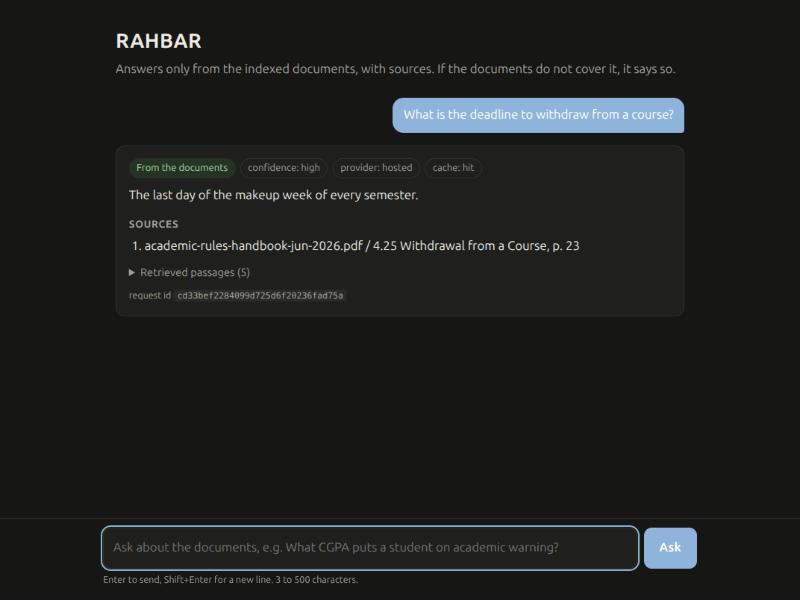
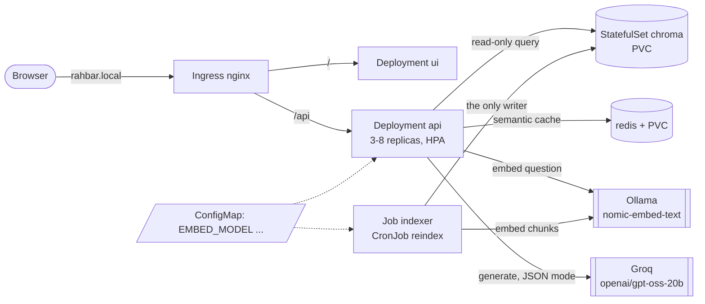

# RAHBAR: grounded answers about FAST-NUCES rules, on Kubernetes

[](https://github.com/AliHaiderBajwa/rahbar/actions/workflows/ci.yml)
[](https://github.com/AliHaiderBajwa/rahbar/actions/workflows/cd.yml)

A 5th-semester student wants to know whether they can withdraw from a course this late,
and the answer depends on which edition of the academic rules you read: the 2023 rules
(still on the website) say "the last day of classes", the 2026 handbook says "the last day
of the makeup week". A general-purpose chatbot will answer confidently from some other
university's rules. **RAHBAR** answers only from the university's own public documents,
cites the clause it used, prefers the current edition unless you ask for an older one,
and says so when the documents do not cover your question. It runs as a set of
Kubernetes objects: a one-shot indexer Job that writes a Chroma index, a three-replica
API that only reads it, a Redis semantic cache, an nginx chat UI and an Ingress, with a
CI gate that fails a pull request when retrieval quality drops.

CS4032 Software Construction & Deployment, Assignment 02 · Ali Haider Bajwa (Systems &
DevOps) and Taimoor Khaliq (RAG core).



## Architecture



One writer, one reader, one shared pin: the indexer Job is the only thing that writes to
Chroma (ADR 0001), the api only reads it, and both read `EMBED_MODEL` from the same
ConfigMap; the api refuses to become ready if the index was built with another model.
More in [docs/ARCHITECTURE.md](docs/ARCHITECTURE.md).

| Path | What it is |
| --- | --- |
| `api/` | FastAPI service: retrieval, generation, cache, grounding rules. Reads the index, never writes it. |
| `indexer/` | The Job's image: extract (with OCR), clean, chunk, embed, store. The only writer. |
| `ui/` | The chat page, served by non-root nginx. |
| `corpus/` | `sources.yaml`, `MANIFEST.md` (URL + SHA-256 per document) and `fetch.py`. The PDFs are not committed. |
| `eval/` | `golden.yaml` (21 questions), `run_eval.py` (the CI gate), `baseline.json`, `results.json`, the chunking sweep and the cache-threshold experiment. |
| `k8s/` | `base/` and overlays: `dev` (minikube), `prod` (Docker Hub, SHA tags), `ci` (ephemeral k3d), `k3d` (our laptop). |
| `docs/` | CORPUS, PIPELINE, FAILURE-ANALYSIS, ENGINEERING-NOTES, AI-USAGE, ADRs 0001-0005, evidence. |

## From a clean clone to an answered question (minikube)

You need Docker, minikube, kubectl, Python 3.12, `make`, [Ollama](https://ollama.com) and a
free [Groq API key](https://console.groq.com/keys). About 6 GB of RAM for minikube.

```bash
git clone https://github.com/AliHaiderBajwa/rahbar.git && cd rahbar
```

**1. Start the cluster** with Calico (the default CNI silently ignores NetworkPolicy),
metrics-server (for the HPA) and the ingress addon:

```bash
make cluster
```

**2. Start Ollama on the host** for embeddings. It must listen on all interfaces so the
cluster can reach it at `host.minikube.internal:11434`:

```bash
OLLAMA_HOST=0.0.0.0 ollama serve
```

```bash
ollama pull nomic-embed-text
```

**3. Build the three images and load them into minikube** (tag `dev`):

```bash
make images
```

**4. Apply, in this order.** The namespace first, so the Secret has somewhere to go; the
Secret from the command line (never from a file); then everything else, which also
starts the indexer Job:

```bash
kubectl apply -f k8s/base/namespace.yaml
```

```bash
export LLM_API_KEY=gsk_your_key_here && make secret
```

```bash
kubectl apply -k k8s/overlays/dev
```

**5. Wait for the index.** The Job's init container downloads the nine documents and
checks their SHA-256s against `corpus/MANIFEST.md`; the indexer then OCRs the two scanned
PDFs, chunks and embeds everything (about 20 minutes on a laptop CPU, most of it OCR and
embedding). Until it finishes, the api pods are Running but **0/1 READY**: `/readyz`
reports that the collection does not exist yet. That is the design, not a bug.

```bash
kubectl -n rahbar wait --for=condition=complete job/indexer --timeout=45m
```

```bash
kubectl -n rahbar rollout status deploy/api
```

**6. Ask through the Ingress.**

```bash
echo "$(minikube ip) rahbar.local" | sudo tee -a /etc/hosts
```

```bash
make ask Q="What CGPA does an undergraduate need to stay off academic warning?"
```

You get a cited answer (clause 5.4, "2.00"). Then ask about something the corpus
deliberately leaves out, and it declines:

```bash
make ask Q="How do I apply for a hostel room?"
```

Open <http://rahbar.local> for the chat UI. Then delete a pod and keep asking: nothing
breaks, because the Service only routes to ready pods and the Deployment replaces it.

```bash
kubectl -n rahbar delete "$(kubectl -n rahbar get pod -l app=api -o name | head -1)"
```

**Re-index without a redeploy** (new documents, or after changing `CHUNK_SIZE`):

```bash
make index
```

On macOS or Windows with the docker driver, run `minikube tunnel` in another terminal and
use `make ask INGRESS_IP=127.0.0.1`. Our own laptop has 3.8 GB of RAM and no minikube, so
we ran the same manifests on k3d (`make k3d-up k3d-images k3d-apply`, overlay
`k8s/overlays/k3d`), where Ollama runs as a container on the cluster's Docker network.

## API

| Method | Path | Purpose |
| --- | --- | --- |
| `POST` | `/api/ask` | `{"question": "..."}` (3-500 characters, else 422) → answer, citations, `answered_from_context`, `confidence`, the retrieved chunks with scores, `cached`. `X-Request-ID` is honoured and echoed. |
| `GET` | `/healthz` | Liveness. The process is alive; touches nothing else. |
| `GET` | `/readyz` | Readiness. 200 only if Chroma answers, the collection exists and is non-empty, its `embed_model` equals ours, and Redis answers; otherwise 503 naming the failed check. |
| `GET` | `/metrics` | Prometheus: requests and latency by route, retrieval and generation latency, cache hit ratio, abstentions and fallbacks by reason, tokens in/out, citations dropped, chunks in the index. |

## Configuration

Everything is in one ConfigMap, [k8s/base/configmap.yaml](k8s/base/configmap.yaml), read
by both the api and the indexer. The ones that matter most:

| Key | Value | Why |
| --- | --- | --- |
| `EMBED_MODEL` | `nomic-embed-text` | The pin. The indexer writes it into the collection; the api checks it. |
| `LLM_PROVIDER` / `LLM_MODEL` | `hosted` / `openai/gpt-oss-20b` (Groq) | ADR 0004. `stub` in CI. |
| `CHUNK_SIZE` / `CHUNK_OVERLAP` | 150 / 30 words | The sweep in PIPELINE.md. |
| `TOP_K` | 5 | |
| `RELEVANCE_FLOOR` | 0.66 | Best cosine below this → abstain without calling the model. Measured: answerable questions ≥ 0.716, off-topic probes ≤ 0.641. |
| `CACHE_THRESHOLD` | 0.96 | Lowest value with zero false hits (PIPELINE.md). |
| `TEMPERATURE` | 0.2 | Facts and JSON; justified in the ConfigMap. |

The Groq key is the only secret. It lives in `Secret/rahbar-secret`, created with
`make secret`; `k8s/base/secret.placeholder.yaml` shows its shape with `REPLACE_ME` and is
not listed in any kustomization. Base64 is encoding, not encryption.

## Development without a cluster

```bash
make install
```

```bash
make test
```

```bash
make lint
```

```bash
make dev
```

`make dev` serves the API and the chat UI on <http://localhost:8000> with the stub
retriever and stub model. `make test` runs 60 tests with no network and no model.

## Evaluation

```bash
make eval
```

`eval/run_eval.py` asks the 21 golden questions through the Ingress, writes
`eval/results.json` and exits non-zero when recall@5 drops more than 5 points below
`eval/baseline.json`, when any must-abstain question is answered, or when citation
validity falls below 95%. In CI the same gate runs on the three-document fixture corpus
in an ephemeral k3d cluster. Results and method: [docs/PIPELINE.md](docs/PIPELINE.md).

## CI/CD

* **`ci.yml`** (pull requests to `main`, pushes to `dev`): lint (ruff, mypy) · test (pytest,
  coverage ≥ 60%, stub provider) · manifests (`kustomize build | kubeconform -strict`) ·
  build (no push) · scan (Trivy: fail on fixable HIGH/CRITICAL) · e2e-eval (k3d cluster,
  fixture index, rollout, eval gate).
* **`cd.yml`** (pushes to `main`): test → build-push (Docker Hub, tagged with the commit
  SHA) → deploy (ephemeral k3d cluster pulling exactly those images, `rollout status`,
  smoke test through the Ingress). Every publishing or deploying job has `needs:`.
* `main` is protected: pull request, passing CI and one approval required.

Images: <https://hub.docker.com/u/alihaiderbajwa> (`rahbar-api`, `rahbar-ui`,
`rahbar-indexer`, tagged by commit SHA, never `:latest`).

## Corpus

Nine public FAST-NUCES documents (two editions of the academic rules, the prospectus
rules, the student handbook, two annual reports, the fee and grading pages, and a scanned
ORIC policy). We do not own them, so we commit `corpus/MANIFEST.md` (URL, size and
SHA-256 of each) and `corpus/fetch.py`, never the files. In the cluster the indexer Job
downloads them itself. Details: [docs/CORPUS.md](docs/CORPUS.md).

## AI assistance

We used Claude Code extensively; [docs/AI-USAGE.md](docs/AI-USAGE.md) says exactly what
it wrote and what we did.

## License

MIT, see [LICENSE](LICENSE). The corpus documents belong to FAST-NUCES and are not part
of this repository.
