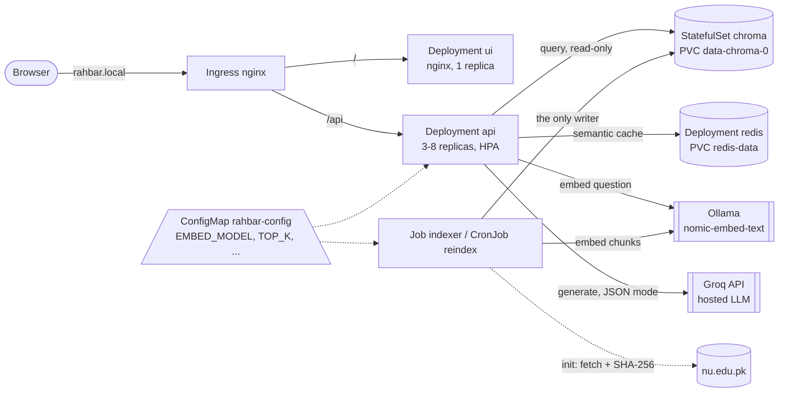

# Architecture

One writer (the indexer Job), one reader (the api), one shared pin (`EMBED_MODEL` in the
ConfigMap, checked against the collection's metadata). Everything runs in namespace
`rahbar`, behind default-deny NetworkPolicies (`k8s/base/networkpolicy.yaml`).

## Why Chroma is a StatefulSet, not a Deployment
Chroma owns data on disk. A StatefulSet gives it:

* **a stable identity and its own volume.** `volumeClaimTemplates` creates
  `data-chroma-0` for pod `chroma-0`, and every replacement `chroma-0` re-attaches that same
  claim. A Deployment's pods are interchangeable; a Deployment with a PVC works only by
  accident, and scaling it would make two pods fight over one ReadWriteOnce volume.
* **at most one pod with that identity at a time.** During an update or a node failure the
  StatefulSet controller does not start the new `chroma-0` until the old one is gone. A
  Deployment's default rolling update would run old and new side by side, two Chroma
  processes on one SQLite file.
* **ordered, predictable start-up and shutdown**, which is what you want from a database.

Redis is a Deployment with a separately declared PVC and `strategy: Recreate` (the old pod
is stopped before the new one mounts the volume). It is a cache: losing it costs latency,
not correctness, so the stronger guarantees of a StatefulSet are not needed there.

## Request path (one question)
1. The Ingress sends `POST /api/ask` to the `api` Service; the request id comes from
   `X-Request-ID` or is generated, and is on every log line.
2. The api embeds the question once (Ollama, `search_query:` prefix).
3. Semantic cache lookup in Redis for the live `index_id` (skipped for follow-ups).
4. Retrieval from Chroma: dense top-k plus a lexical leg for exact terms, fused with RRF,
   with `superseded: false` unless the question asks about an older edition.
5. Relevance floor: if the best similarity is below `RELEVANCE_FLOOR`, abstain without
   calling the model.
6. Prompt: rules, then numbered `<evidence>` blocks (tags neutralised), then `<question>`.
7. Groq in JSON mode → Pydantic validation → one retry → safe fallback.
8. Citation guard: every citation must match a retrieved chunk, or it is dropped; an
   answer left with no valid citation is withdrawn.
9. One JSON log line (top_k, chunk ids, scores, abstention, tokens); the turn is stored;
   the answer is cached only if it is grounded, cited and not a follow-up.
